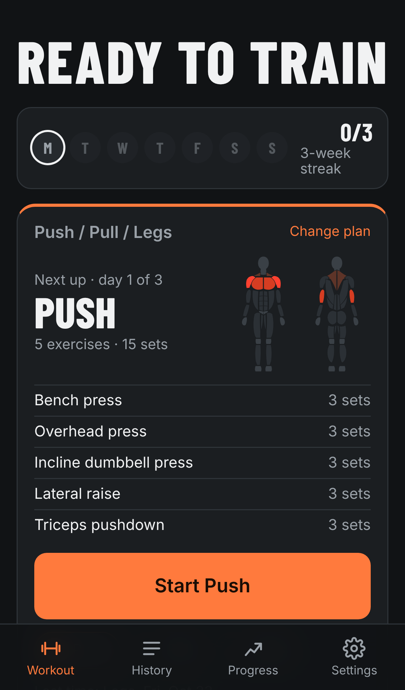
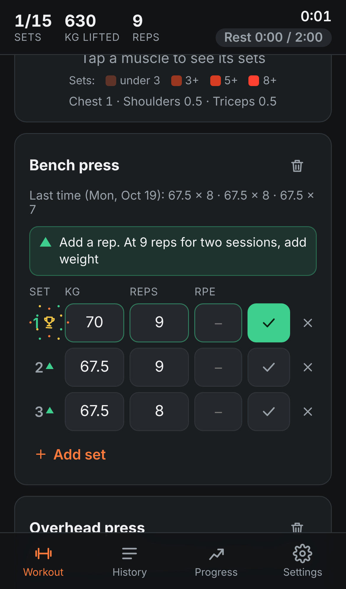
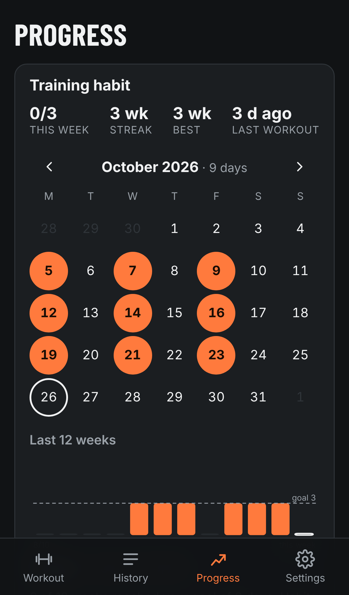
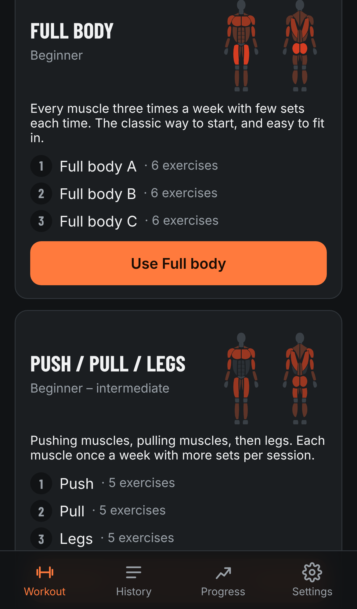

# Workout

A simple workout tracker for your phone. Without accounts, subscriptions or cookies.

https://petr9janousek.github.io/workout/

  
  
  
  

You log your sets, and next time it suggests a bit more. There are ready-made plans, a muscle map, a training calendar and a few charts. It's free, there's no sign-up, and it works offline.

## Install

Open the link on your phone, then:

- iPhone: Safari, Share, Add to Home Screen
- Android: Chrome, menu, Install app

## Your data

Everything is stored on your phone only. If you delete the app or change phones, it's gone, so save a backup now and then (Settings, Save backup).

The site counts visits anonymously with [GoatCounter](https://www.goatcounter.com). No cookies, and it never sees your workouts.

## Development

See [DOCUMENTATION.md](DOCUMENTATION.md). MIT [license](LICENSE).
